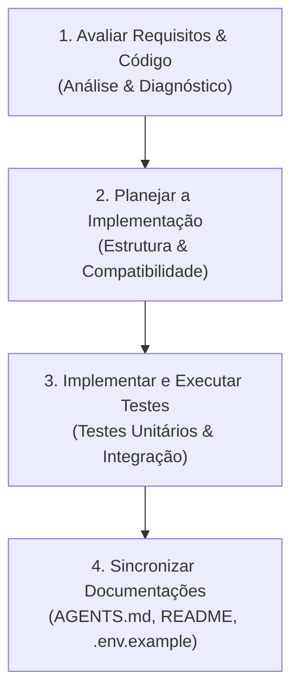

# AGENTS.md — Diretrizes para Agentes Autônomos de Programação

Este documento centraliza as diretrizes arquiteturais, padrões de engenharia de software, regras de conduta operacional e instruções para agentes autônomos de IA que colaboram no repositório **paulo-investimentos-pessoais**.

---

## 🎯 1. Visão Geral e Propósito do Projeto

O **Paulo Investimentos Pessoais** é uma plataforma e ecossistema analítico financeiro desenvolvido em **Python** com **Streamlit**, desenhado para gestão patrimonial, inteligência financeira, acompanhamento de carteira e controle orçamentário.

### Principais Capacidades:
- **Painel Patrimonial & Visualização (Streamlit + Plotly):** Saldo patrimonial líquido, distribuição por classe de ativos (Ações BR, FIIs, Stocks/ETFs EUA, Renda Fixa), acompanhamento de metas orçamentárias e fluxo de caixa.
- **Cálculo de Desempenho & Benchmarks:** Rentabilidade histórica por cotas (**TWR - Time-Weighted Rate of Return**), splits oficiais e comparativo direto contra benchmarks de mercado (**CDI, IPCA, Ibovespa e S&P 500**) a partir de APIs financeiras e cotações em tempo real (`yfinance`).
- **Análise Fundamentalista:** Balanço Patrimonial, DRE e Fluxo de Caixa histórico importados automaticamente para múltiplos anos/trimestres.
- **Consultoria por Inteligência Artificial:** Recomendações didáticas de alocação de carteira baseadas em princípios financeiros modernos via **Google Gemini**.
- **Ingestão Inteligente & Conciliação Híbrida:** Leitura multimodal de comprovantes (OCR com Gemini Vision e Pydantic), decodificação de arquivos bancários (.OFX / .CSV), Open Finance via Pluggy e editor interativo (`st.data_editor`) com detector de duplicidades por hash SHA-256.
- **Camada de Dados Híbrida (Google Sheets + SQLite Local):**
  - *Google Sheets:* Fonte da verdade histórica do usuário (`gspread` e OAuth em `credentials.json`).
  - *SQLite Local (`data/investimentos.db` / `data/financas.db`):* Cache relacional de alta performance para sincronização incremental (Delta Sync), cotações e histórico contábil.

---

## 🔄 2. Ciclo de Engenharia Obrigatório por Tarefa

Todos os agentes autônomos devem seguir o fluxo estruturado de engenharia:



### 1️⃣ Avaliar Requisitos & Código (Análise & Diagnóstico)
- Ler atentamente os arquivos envolvidos antes de aplicar modificações.
- Avaliar impactos no esquema SQLite, contratos de dados com o Google Sheets, e interfaces do Streamlit.
- Verificar testes existentes em `tests/` antes de realizar refatorações.

### 2️⃣ Planejar a Implementação (Planejamento Estruturado)
- Estruturar em passos claros as mudanças a serem realizadas.
- Preservar integridade de regras financeiras (fórmulas TWR, conversões cambiais e cálculos contábeis).
- Garantir que comentários técnicos e docstrings pré-existentes sejam preservados.

### 3️⃣ Implementar e Executar Testes Automatizados (Validação Rigorosa)
- Novas funcionalidades, parsers ou correções de regras de cálculo devem ser acompanhadas de testes automatizados (`tests/unit/`, `tests/integration/`).
- Executar a suíte de testes com runner de integridade:
  ```bash
  python tests/run_all.py
  # Ou testes específicos:
  pytest tests/unit/
  ```
- **Critério de Aceite:** 100% de aprovação na suíte de testes (0 falhas, 0 erros).

### 4️⃣ Sincronizar Documentações (Sincronização & Persistência)
- Refletir adições de variáveis de ambiente no `.env.example`.
- Manter o `AGENTS.md`, `README.md` e docstrings alinhados às novas implementações e parsers de instituições financeiras.

---

## 🏛️ 3. Arquitetura do Sistema e Estrutura de Diretórios

```text
paulo-investimentos-pessoais/
├── 00-iniciar.cmd              # Atalho de execução rápida para Windows
├── 00-iniciar.sh               # Inicializador para Linux / WSL (Docker Compose)
├── AGENTS.md                   # Diretrizes universais para agentes autônomos (este arquivo)
├── dashboard.py                # Ponto de entrada e orquestrador principal do Streamlit
├── Dockerfile                  # Container Python 3.12-slim-bookworm otimizado
├── docker-compose.yml          # Orquestração do app Streamlit de desenvolvimento (porta 8502)
├── docker-compose.server.yml   # Orquestração para servidor de produção / homelab
├── requirements.txt            # Dependências gerenciadas (Streamlit, Pandas, Plotly, yfinance, gspread, etc.)
├── cspell.json                 # Dicionário de termos do verificador ortográfico
│
├── assets/                     # Recursos visuais e estilização
│   └── css/styles.css          # Design system, glassmorphism e tema escuro
│
├── data/                       # Armazenamento local de credenciais e bancos
│   ├── credentials.json        # Chave de Serviço Google Cloud (ignorado no Git)
│   ├── investimentos.db        # Banco de dados local SQLite
│   └── financas.db             # Banco de dados complementar SQLite
│
├── logs/                       # Logs rotativos particionados (3MB, máx 3 arquivos rotacionados)
│   ├── app/                    # Ciclo de vida e eventos gerais
│   ├── components/             # Eventos do header e barra lateral
│   ├── database/               # Logs de transações e delta sync do SQLite
│   ├── services/               # Logs de conectores externos e APIs
│   └── tabs/                   # Logs específicos de cada aba/módulo
│
├── src/                        # Código-fonte modular da aplicação
│   ├── components/             # Componentes de UI reutilizáveis
│   │   ├── header.py           # Header da aplicação com popover/drawer de navegação
│   │   └── sidebar.py          # Barra lateral com seletores de ano, conexões e status
│   ├── database/               # Camada de persistência local SQLite
│   │   └── db_manager.py       # Gestão de conexões, delta sync, criação de tabelas e índices
│   ├── services/               # Regras de negócio, integrações e cálculo
│   │   ├── data_loader.py      # Carga e sanitização Google Sheets / SQLite
│   │   ├── analytics.py        # Motor de cálculos TWR, cotações e benchmarks
│   │   ├── ai_allocator.py     # Consultoria e otimização de carteira via Gemini
│   │   ├── deduplication.py    # Gerador de hash SHA-256 e detector inteligente de duplicidades
│   │   ├── ingestion_parser.py # Parsers de extratos OFX, CSV e OCR multimodal
│   │   └── pluggy_service.py   # Conector com Open Finance (Pluggy API)
│   ├── tabs/                   # Telas / Abas modulares do painel
│   │   ├── visao_geral.py      # Visão geral patrimonial, orçamentos e fluxo
│   │   ├── desempenho.py       # Desempenho histórico e benchmarks
│   │   ├── extratos.py         # Extratos analíticos com filtros
│   │   ├── fundamentalista.py  # Análise de ações, FIIs e demonstrativos
│   │   ├── consultoria_ia.py   # Consultoria e recomendações via IA
│   │   ├── importar_gastos.py  # Ingestão de extratos/comprovantes e conciliação
│   │   ├── editor_planilhas.py # Editor interativo de dados
│   │   └── configuracoes.py    # Credenciais, status de APIs e diagnósticos
│   ├── utils/                  # Utilitários compartilhados
│   │   ├── formatting.py       # Formatação monetária PT-BR, porcentagens e normalizações
│   │   ├── logger.py           # Logger rotativo centralizado com filtro de redação de segredos
│   │   └── security.py         # Fail-Closed Auth, PBKDF2, HMAC, whitelists e defesa DoS/XSS/XXE/Zip-Bomb
│
├── scripts/                    # Scripts utilitários de diagnóstico, manutenção e migração
│   ├── auto_ajustar_splits.py  # Script de reconciliação de desdobramentos de ações
│   ├── corrigir_planilha.py    # Sanitização e correção em lote de registros
│   └── diagnostico.py          # Validação de integridade do ambiente e banco
│
├── tests/                      # Suíte de testes automatizados
│   ├── conftest.py             # Fixtures e mocks compartilhados do Pytest
│   ├── run_all.py              # Runner customizado unificado
│   ├── test_helpers.py         # Helpers para injeção de dados de teste
│   ├── unit/                   # Testes unitários de serviços e utilitários
│   └── integration/            # Testes de integração (fluxo SQLite, delta sync, parsers)
│
└── Docs/                       # 📚 Central Unificada de Documentação Técnica
    ├── README.md               # Índice mestre navegável com hyperlinks
    ├── arquitetura/            # Decisões de engenharia, banco híbrido, TWR e parsers
    ├── guias/                  # Manuais de deploy, credenciais, conciliação e manutenção
    ├── testes/                 # Documentação e execução da suíte de testes
    └── issues/                 # Backlog e histórico de entregas
```

---

## 🎨 4. Diretrizes de Geração de Código e Formatação

1. **Padrão Numérico Brasileiro (PT-BR):**
   - Valores exibidos em cards, tabelas e gráficos devem usar vírgula como separador decimal e ponto como separador de milhar (ex: `R$ 1.250,50`).
2. **Moedas e Conversão Cambial Dinâmica:**
   - Exibir máscaras apropriadas de acordo com a origem (`R$ #.###,##` ou `US$ #.###,##`).
   - Nas consolidações globais da carteira, unificar o patrimônio em BRL utilizando a cotação cambial em tempo real.
3. **Diretrizes de Segurança (SecOps & Fail-Closed):**
   - Nunca armazene segredos, tokens, IPs privados de infraestrutura ou senhas em arquivos versionados; mantenha `.env` com permissão `chmod 600` e `data/credentials.json` protegido.
   - Preserve validações via `src/utils/security.py` (whitelists de identificadores SQL, tickers e Spreadsheet IDs, `sanitize_html`, `sanitize_spreadsheet_cell`, limites anti-Zip-Bomb/DoS e redação de logs).
   - Serviços e WebUI devem operar em **Fail-Closed**: não iniciar ou autenticar caso `REQUIRE_AUTH=true` esteja sem `DASHBOARD_AUTH_PASSWORD_HASH` / `DASHBOARD_SESSION_SECRET`.
4. **Respostas Diretas e Eficientes:**
   - Otimize para concisão e alta densidade técnica.
   - Forneça dados estruturados e código limpo, sem prolixidade.

