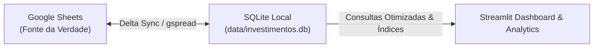

# Camada de Dados Híbrida: Google Sheets + SQLite Local

> **Objetivo:** Documentar a integração entre a fonte de verdade na nuvem (Google Sheets) e o cache local relacional (SQLite), detalhando a sincronização incremental (Delta Sync).

---

## 1. Princípio da Arquitetura Híbrida

O sistema adota uma estratégia de dois níveis de persistência:

### Por que híbrido?
- **Google Sheets:** Permite edição fácil e rápida de lançamentos em qualquer dispositivo móvel ou navegador pelo usuário, sem necessidade de interface administrativa pesada.
- **SQLite Local:** Oferece velocidade milissegunda para agregações pesadas, janelas temporais de rentabilidade, joins entre ordens e cotações diárias, além de contornar limites de cota da API do Google Sheets (*Rate Limiting*).

---

## 2. Estrutura do Banco SQLite (`data/investimentos.db`)

As tabelas gerenciadas por `src/database/db_manager.py` incluem:

- **`ordens`:** Registro histórico de compras, vendas, splits e bonificações de ativos.
- **`despesas` / `receitas`:** Histórico de lançamentos orçamentários por ano e categoria.
- **`proventos`:** Dividendos, JCP e rendimentos de FIIs recebidos.
- **`cotacoes`:** Cache de cotações históricas diárias obtidas do `yfinance`.
- **`demonstrativos`:** Dados de Balanço Patrimonial, DRE e Fluxo de Caixa histórico.
- **`hashes_transacoes`:** Tabela de assinaturas SHA-256 para prevenção de duplicidades.

---

## 3. Mecanismo de Delta Sync

A sincronização realizada em `src/services/data_loader.py` opera de forma incremental:

1. **Checagem de Metadados:** Verifica hashes e datas de modificação das abas do Google Sheets.
2. **Carga em Lote (Batch Fetch):** Lê os dados necessários reduzindo o consumo de chamadas da API (`gspread`).
3. **Upsert no SQLite:** Atualiza registros alterados e insere novos lançamentos mantendo integridade referencial.
4. **Append Seguro:** Ao conciliar novos gastos na interface do Streamlit, os registros são gravados atomicamente no SQLite e adicionados na respectiva aba do Google Sheets.

