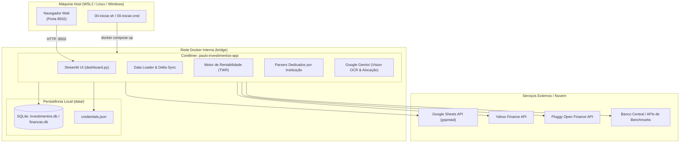

# Paulo Investimentos Pessoais — Dossiê de Contexto Global da Arquitetura

> **Data de Atualização:** Novembro de 2026  
> **Status:** Ativo / Produção Pessoal  
> **Objetivo:** Ponto de restauração, alinhamento técnico e entendimento global do ecossistema Paulo Investimentos Pessoais.
>
> 📌 *O mapa de navegação e índice mestre de documentação encontra-se em [Docs/README.md](../README.md).*

---

## 1. Visão Geral do Sistema

O **Paulo Investimentos Pessoais** é um ecossistema completo para gestão patrimonial, inteligência financeira, acompanhamento de custódia e controle orçamentário.

- **Propósito:** Oferecer visibilidade patrimonial consolidada (Ações Brasil, FIIs, Stocks/ETFs EUA, Renda Fixa), acompanhamento em tempo real contra benchmarks de mercado (**CDI, IPCA, Ibovespa, S&P 500**), gestão orçamentária granular e conciliação bancária inteligente com suporte a IA generativa.
- **Princípios Arquiteturais:**
  1. **Velocidade & Responsividade:** Cache relacional local SQLite para consultas instantâneas e visualizações fluidas no Streamlit/Plotly sem sobrecarga de requisições de rede.
  2. **Fonte da Verdade Desacoplada:** Planilhas do Google Sheets mantêm o histórico perene e editável pelo usuário, integradas via Delta Sync incremental.
  3. **Resiliência de Ingestão:** Dispatchers específicos por instituição financeira para tratar peculiaridades de sinais (+/-), layouts e tags OFX/CSV.
  4. **Execução Containerizada:** Ambiente 100% reprodutível via Docker Compose sem dependência de dependências locais na máquina host.

---

## 2. Topologia de Infraestrutura & Contêineres

O ecossistema é orquestrado via **Docker Compose**:

---

## 3. Módulos e Componentes do Sistema

1. **Dashboard & UI (`dashboard.py`, `src/components/`, `src/tabs/`):**
   - Streamlit reativo com navegação via drawer popover flutuante e URL query parameters (`?tab=...&subtab=...`).
   - Módulos de Visão Geral, Desempenho, Extratos, Fundamentalista, Consultoria com IA, Importação de Gastos, Editor de Planilhas e Configurações.
2. **Serviços de Negócio (`src/services/`):**
   - `analytics.py`: Rentabilidade ponderada pelo tempo (**TWR**), normalização de cotações, splits e cálculo de custódia.
   - `data_loader.py`: Sanitização e sincronização bidirecional entre Google Sheets e SQLite.
   - `deduplication.py`: Assinaturas digitais SHA-256 e detecção de lançamentos duplicados.
   - `ai_allocator.py`: Sugestões de rebalanceamento via Gemini API com base em modelos de alocação de ativos.
   - `ingestion_parser.py` e `src/services/parsers/`: Ingestão multimodal e bancária estruturada.
3. **Persistência (`src/database/db_manager.py`):**
   - Criação automática de tabelas, índices e controle transacional local para histórico de ordens, orçamentos, proventos e cotações.

