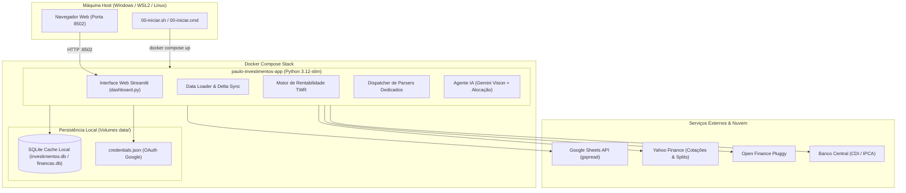

# 📈 Paulo Investimentos Pessoais — Plataforma Financeira & Inteligência Patrimonial

<div align="center">


**Plataforma analítica e orquestrador financeiro para gestão patrimonial, inteligência de alocação, rentabilidade TWR e conciliação bancária.**

[Central de Documentação (Docs)](Docs/README.md) • [Diretrizes de Engenharia (AGENTS.md)](AGENTS.md) • [Guia de Deploy Docker](Docs/guias/instalacao_e_deploy_docker.md)

</div>

---

## 📋 Sumário Executivo

- [1. Visão Geral](#-1-visão-geral)
- [2. Arquitetura do Sistema](#-2-arquitetura-do-sistema)
- [3. Módulos & Funcionalidades](#-3-módulos--funcionalidades)
  - [3.1 Painel Patrimonial & Visão Geral](#31-painel-patrimonial--visão-geral)
  - [3.2 Rentabilidade Histórica por Cotas (TWR) & Benchmarks](#32-rentabilidade-histórica-por-cotas-twr--benchmarks)
  - [3.3 Extratos Analíticos, Receitas & Despesas](#33-extratos-analíticos-receitas--despesas)
  - [3.4 Análise Fundamentalista (Ações & FIIs)](#34-análise-fundamentalista-ações--fiis)
  - [3.5 Consultoria & Alocação Inteligente com IA](#35-consultoria--alocação-inteligente-com-ia)
  - [3.6 Ingestão Inteligente & Conciliação Híbrida](#36-ingestão-inteligente--conciliação-híbrida)
  - [3.7 Editor Interativo de Dados & Planilhas](#37-editor-interativo-de-dados--planilhas)
  - [3.8 Configurações do Sistema & Diagnósticos](#38-configurações-do-sistema--diagnósticos)
- [4. Estrutura de Diretórios](#-4-estrutura-de-diretórios)
- [5. Como Executar (Docker Compose / WSL)](#-5-como-executar-docker-compose--wsl)
- [6. Deep Linking & URLs Rápidas](#-6-deep-linking--urls-rápidas)
- [7. Suíte de Testes Automatizados](#-7-suíte-de-testes-automatizados)
- [8. Central de Documentação Técnica](#-8-central-de-documentação-técnica)

---

## 🎯 1. Visão Geral

O **Paulo Investimentos Pessoais** é um ecossistema completo de engenharia financeira e inteligência patrimonial desenvolvido em **Python** com **Streamlit**, desenhado para unificar a gestão de investimentos (Ações Brasil, FIIs, Stocks/ETFs EUA e Renda Fixa) com o controle orçamentário mensal e anual.

A plataforma combina a flexibilidade do **Google Sheets** (como repositório perene na nuvem) com o poder analítico e a velocidade do **SQLite local**, permitindo consolidações instantâneas, conciliações inteligentes de extratos bancários com parsers dedicados e consultoria automatizada de alocação através do **Google Gemini**.

---

## 🏛️ 2. Arquitetura do Sistema

O ecossistema opera de forma desacoplada e 100% containerizada via **Docker Compose**:



---

## 🚀 3. Módulos & Funcionalidades

### 3.1 Painel Patrimonial & Visão Geral
- Saldo patrimonial líquido total e consolidação em moeda corrente nacional (**BRL**) com conversão cambial dinâmica em tempo real para ativos internacionais.
- Distribuição por classe de ativos (Ações BR, FIIs, Stocks/ETFs EUA, Renda Fixa) em gráficos interativos de pizza/treemap via Plotly.
- Indicadores de fluxo de caixa orçamentário, metas anuais e acompanhamento de aportes.

### 3.2 Rentabilidade Histórica por Cotas (TWR) & Benchmarks
- Rentabilidade calculada pela metodologia oficial **Time-Weighted Rate of Return (TWR)**, eliminando distorções de entradas e saídas de caixa.
- Reconciliação automática de desdobramentos (*splits*) e grupamentos de ações da B3.
- Comparativo direto da curva de patrimônio contra benchmarks oficiais: **CDI, IPCA, IPCA+6%, Ibovespa (^BVSP) e S&P 500 (^GSPC)**.

### 3.3 Extratos Analíticos, Receitas & Despesas
- Filtragem avançada e visualização analítica por subabas: receitas, despesas, dividendos/JCP e ordens de compra/venda.
- Visualização por competência temporal, contas e centros de custo.

### 3.4 Análise Fundamentalista (Ações & FIIs)
- Balanço Patrimonial, DRE e Fluxo de Caixa histórico importados automaticamente via `yfinance` para múltiplos anos e trimestres.
- Indicadores múltiplos de valuation (P/L, P/VP, Dividend Yield, ROE, Dívida Líquida/EBITDA).

### 3.5 Consultoria & Alocação Inteligente com IA
- Recomendações didáticas e alocação de carteira orientadas por princípios financeiros modernos de diversificação.
- Análise de balanceamento de risco/retorno apoiada pela API do **Google Gemini**.

### 3.6 Ingestão Inteligente & Conciliação Híbrida
- **OCR Multimodal:** Leitura de comprovantes de pagamento e Pix via **Gemini Vision** com parsing estruturado via Pydantic.
- **Parsers Dedicados por Banco:** Padrão Strategy para arquivos `.OFX` e `.CSV` com regras específicas de sinais e cabeçalhos para:
  - 🏦 Sicredi, Banco Inter, C6 Bank, Nubank, 99 Pay, Mercado Pago, XP/B3 e Cartões de Loja (Vuon/Renner).
- **Detecção de Duplicidades:** Assinatura digital SHA-256 por transação para identificação de lançamentos repetidos no `st.data_editor`.

### 3.7 Editor Interativo de Dados & Planilhas
- Grade editável (`st.data_editor`) para revisão, ajuste em lote e conciliação direta com gravação atômica no SQLite e Google Sheets.

### 3.8 Configurações do Sistema & Diagnósticos
- Monitoramento de status de conexões e APIs (Google Sheets, Gemini, Pluggy, Yahoo Finance).
- Diagnóstico de consistência contábil e disparadores de sincronização manual.

---

## 📁 4. Estrutura de Diretórios

```text
paulo-investimentos-pessoais/
├── 00-iniciar.cmd              # Atalho de execução rápida para Windows
├── 00-iniciar.sh               # Inicializador para Linux / WSL (Docker Compose)
├── AGENTS.md                   # Diretrizes universais para agentes autônomos
├── dashboard.py                # Ponto de entrada e orquestrador principal do Streamlit
├── Dockerfile                  # Container Python 3.12-slim-bookworm otimizado
├── docker-compose.yml          # Orquestração do app Streamlit de desenvolvimento (porta 8502)
├── docker-compose.server.yml   # Orquestração para servidor de produção / homelab
├── requirements.txt            # Dependências gerenciadas
├── cspell.json                 # Dicionário do verificador ortográfico
│
├── Docs/                       # 📚 Central Unificada de Documentação Técnica
│   ├── README.md               # Índice mestre navegável com hyperlinks
│   ├── arquitetura/            # Dossiê de arquitetura, banco híbrido, TWR e parsers
│   ├── guias/                  # Deploy Docker, Google Sheets, conciliação e manutenção
│   ├── testes/                 # Guia da suíte de testes automatizados
│   └── issues/                 # Backlog oficial e histórico de entregas
│
├── assets/                     # Recursos visuais e estilização
│   └── css/styles.css          # Design system, glassmorphism e tema escuro
│
├── data/                       # Armazenamento local de credenciais e bancos
│   ├── credentials.json        # Chave de Serviço Google Cloud (ignorado no Git)
│   ├── investimentos.db        # Banco de dados local SQLite
│   └── financas.db             # Banco de dados complementar SQLite
│
├── logs/                       # Logs rotativos particionados (3MB, máx 3 backups)
│   ├── app/                    # Ciclo de vida e eventos gerais
│   ├── components/             # Eventos do header e barra lateral
│   ├── database/               # Logs de transações e delta sync do SQLite
│   ├── services/               # Logs de conectores externos e APIs
│   └── tabs/                   # Logs específicos de cada aba/módulo
│
├── src/                        # Código-fonte modular da aplicação
│   ├── components/             # Componentes de UI reutilizáveis (header, sidebar)
│   ├── database/               # Camada de persistência SQLite (db_manager.py)
│   ├── services/               # Motores de cálculo, conectores e inteligência
│   │   ├── parsers/            # Parsers dedicados por instituição bancária
│   │   ├── data_loader.py      # Carga e sanitização Google Sheets / SQLite
│   │   ├── analytics.py        # Motor de cálculos TWR, cotações e benchmarks
│   │   ├── ai_allocator.py     # Consultoria e otimização de carteira via Gemini
│   │   ├── deduplication.py    # Gerador de hash SHA-256 e detector de duplicidades
│   │   ├── ingestion_parser.py # Ingestão de extratos OFX, CSV e OCR multimodal
│   │   └── pluggy_service.py   # Conector com Open Finance (Pluggy API)
│   ├── tabs/                   # Telas / Abas modulares do painel Streamlit
│   └── utils/                  # Utilitários compartilhados (formatting, logger)
│
├── scripts/                    # Scripts utilitários de diagnóstico, manutenção e migração
│   ├── auto_ajustar_splits.py  # Script de reconciliação de desdobramentos de ações
│   ├── corrigir_planilha.py    # Sanitização e correção em lote de registros
│   └── diagnostico.py          # Validação de integridade do ambiente e banco
│
└── tests/                      # Suíte de testes automatizados
    ├── conftest.py             # Fixtures e mocks compartilhados do Pytest
    ├── run_all.py              # Runner customizado unificado
    ├── test_helpers.py         # Helpers para injeção de dados de teste
    ├── unit/                   # Testes unitários de serviços e utilitários
    └── integration/            # Testes de integração (fluxo SQLite, delta sync, parsers)
```

---

## ⚡ 5. Como Executar (Docker Compose / WSL)

### 1. Clonar ou Acessar o Diretório

```bash
cd ~/Documentos/DevProjects/Python/paulo-investimentos-pessoais
```

### 2. Configurar o Arquivo `.env`, Autenticação Fail-Closed e Credenciais

```bash
cp .env.example .env
chmod 600 .env
```

Preencha os IDs das planilhas, a `GEMINI_API_KEY`, gere o hash de acesso (`DASHBOARD_AUTH_PASSWORD_HASH`) e o segredo de sessão (`DASHBOARD_SESSION_SECRET`), e salve `credentials.json` em `data/credentials.json` (com `chmod 600`). O painel opera em modo **Fail-Closed** com bind padrão restrito a `127.0.0.1`. Para instruções completas, consulte o [Guia de Configuração de Credenciais](Docs/guias/configuracao_google_sheets_e_credenciais.md).

### 3. Iniciar a Aplicação

```bash
chmod 755 00-iniciar.sh
./00-iniciar.sh
```

A interface web estará disponível localmente em: **`http://127.0.0.1:8502`** (ou via túnel SSH em ambientes remotos).

---

## 🧭 6. Deep Linking & URLs Rápidas

A aplicação sincroniza o estado das abas e subabas nos parâmetros da URL do navegador:

| Módulo | Parâmetro de URL | Subabas Disponíveis (`&subtab=`) |
| :--- | :--- | :--- |
| **📊 Visão Geral e Orçamento** | `?tab=visao_geral` | — |
| **📈 Desempenho e Benchmarks** | `?tab=desempenho` | — |
| **📑 Extratos e Lançamentos** | `?tab=extratos` | `&subtab=receitas`, `&subtab=despesas`, `&subtab=dividendos`, `&subtab=ordens` |
| **🔍 Análise Fundamentalista** | `?tab=fundamentalista` | `&subtab=balanco`, `&subtab=dre`, `&subtab=fluxo` |
| **🤖 Consultoria de Alocação com IA** | `?tab=consultoria_ia` | — |
| **📥 Ingestão & Conciliação** | `?tab=importar_gastos` | `&subtab=comprovantes`, `&subtab=arquivos`, `&subtab=open_finance` |
| **📝 Editor de Planilhas** | `?tab=editor_planilhas` | — |
| **⚙️ Configurações do Sistema** | `?tab=configuracoes` | — |

---

## 🧪 7. Suíte de Testes Automatizados

A integridade funcional e de segurança do sistema é garantida por uma suíte completa de testes automatizados (incluindo varredura de segredos em `git ls-files`, travas Fail-Closed, testes negativos HTTP `401`/`429` e validação de sanitização):

```bash
# Execução recomendada via launcher (monta tests/ e scripts/ em modo somente leitura)
./00-iniciar.sh --test

# Ou com o contêiner ativo (passando os volumes de teste)
docker compose run --rm -v "$(pwd)/tests:/app/tests:ro" -v "$(pwd)/scripts:/app/scripts:ro" app python tests/run_all.py

# Ou execução específica via pytest
docker compose run --rm -v "$(pwd)/tests:/app/tests:ro" app pytest tests/unit/test_security.py -v
```

Para mais detalhes de configuração de mocks e fixtures, consulte o [Manual da Suíte de Testes](Docs/testes/suite_de_testes_automatizados.md).

---

## 📚 8. Central de Documentação Técnica

Para documentação aprofundada de regras de negócio, modelagem de banco de dados, fluxos de OCR e manuais de operação, acesse a [Central de Documentação Técnica em Docs/](Docs/README.md).
